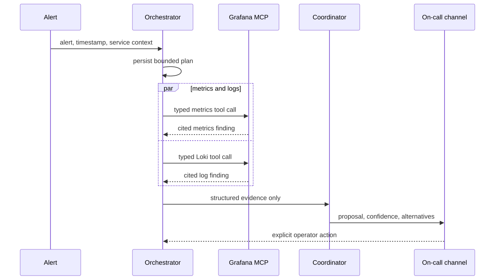

<!-- _class: lead -->

# Building a Root Cause Analytics Engine with Prometheus, Grafana, and MCP

## The pattern I built for a client, rebuilt as a demo you can run

`your name` · Kubernetes Day / CNCF community talk

<!-- Speaker notes, 1 minute: This started at a fintech client I cannot name. Everything you will see today is the same design running on synthetic data, and the whole thing fits in a public repo. Set expectations now: this is not autonomous remediation, and it does not replace the on-call engineer. -->

---

# Alerts tell you users are hurting, not why

An alert says people are affected. It does not say what changed first, which service is the source, how far the damage spread, or what to look at next. You work that out yourself, at 3am, across dashboards, logs, and runbooks.

<div class="cols">
<div>

## The on-call loop

```text
alert → dashboard → logs
→ another dashboard → runbook
→ human hypothesis
```

</div>
<div>

## Where this came from

This pattern came out of work for a fintech client under NDA. No company name, no topology, no production data, no volumes, no vendors, no real incidents in this talk. Everything runs on synthetic data.

</div>
</div>

<!-- Speaker notes, 1 minute: Ask who in the room has lived this loop. The costly part of an incident is not the alert, it is rebuilding a defensible explanation across three systems. That reconstruction is the part we are going after. -->

---

# The obvious fix: point an agent at the logs

```text
Alert → agent → raw logs + kubectl → incident summary
```

| The broad first question | What you get back |
| --- | --- |
| “Why is checkout failing?” | which service, which labels, which window? |
| large raw result set | slow, expensive, rate-limited |
| partial evidence | a confident story with nothing behind it |

<div class="callout">
No prompt makes an unbounded evidence surface cheap, predictable, or safe.
</div>

<!-- Speaker notes, 1.5 minutes: The failure is not the CLI and not the model. It is the evidence surface: unlimited. A broad first question is ambiguous, retrieval is slow and rate-limited, and partial evidence invites a confident story with no proof. Better prompts bound nothing. -->

---

# The design pivot: bound the evidence first

```text
What bounded evidence answers the first five minutes?
```

Metrics answer the cheap questions first: what failed, when it started, which services moved together, what they probably share. Logs come second, to test a hypothesis that is already narrow.

| Telemetry dimension | What it buys you |
| --- | --- |
| service, status, latency | scope and severity |
| dependency direction | a causal hypothesis |
| deploy or change marker | what changed |
| trace identifier, where available | request-level proof |

<!-- Speaker notes, 1 minute: Metrics establish correlation, not causation. Their job is cheap, consistent narrowing, so the expensive evidence lands on a small question. Walk the table as the four things the first five minutes actually need. -->

---

# Grafana is the evidence plane



Prometheus, Loki, and optional Tempo remain the sources of truth. Grafana is the plane where their evidence lines up. An MCP gateway sits in front of it and exposes a short list of approved, read-only questions.

<!-- Speaker notes, 1 minute: People expect MCP to be the center of a design like this. Here it is a boundary around retrieval, and that is the deliberate choice. Say that plainly, it is the thesis of the talk. -->

---

# From client system to something you can clone

| At the client | In this repo |
| --- | --- |
| bounded Prometheus and Loki evidence queries | fixed templates over a three-service demo |
| incident scope, state, and evidence contracts | a local persisted workflow with structured findings |
| human approval before remediation | an explicit operator transition in the CLI |
| production integrations, identities, policy | contained fault injection, no production credentials |

The repo demonstrates the controls and the shape of the workflow. It does not copy client topology, telemetry, volumes, or incident data.

<!-- Speaker notes, 1 minute: The pattern was built and used in the client environment. The repo is the smallest public-safe reproduction I could make: same controls, same workflow shape, synthetic everything. Nothing from the client is in it. -->

---

# The model never writes PromQL

<div class="cols">
<div class="code-panel">

```js
const queries = {
  current_incidents:
    'ALERTS{alertstate="firing"}',
  service_health: (service) =>
    `service:http_error_ratio:rate5m` +
    `{service="${service}"} or ` +
    `service:http_p95_latency_seconds:rate5m` +
    `{service="${service}"}`,
};

function assertService(service) {
  if (!['checkout', 'orders', 'payments']
    .includes(service)) throw new Error('unknown service');
}
```

</div>
<div>

## What the gateway does

It picks from reviewed recording-rule templates and checks the service against an allowlist. The model chooses from a menu, it never authors a query.

The demo hard-codes three services. Production scope comes from the persisted incident plan and the service catalog.

</div>
</div>

<!-- Speaker notes, 1.5 minutes: This slide is the heart of the demo. Two controls combine here: fixed templates bound the cost, and the allowlist blocks accidental scope creep. The next slide shows the same rule enforced in the tool schema. -->

---

# Tool schemas are executable policy

<div class="cols">
<div class="code-panel">

```js
{
  name: 'service_health',
  inputSchema: {
    type: 'object',
    properties: { service: {
      type: 'string',
      enum: ['checkout', 'orders', 'payments']
    } },
    required: ['service'],
    additionalProperties: false
  }
}
```

</div>
<div>

## The boundary

- typed, read-only evidence tools
- source, service, time, and result caps on every call
- every finding cites the query that produced it
- no shell, no kubectl, no arbitrary PromQL or LogQL, no dashboard mutation

<span class="note">Illustrative implementation. The public repo includes the bounded Loki tools; production can add Tempo with the same input model.</span>

</div>
</div>

<!-- Speaker notes, 1 minute: The schema is the policy, checked in software rather than requested in a prompt. MCP standardizes how tools get called. Approval state, identity, and governance stay on our side of the boundary. -->

---

# Every state change is a decision someone made



`Investigate another hypothesis` is an explicit return to planning, never a hidden retry loop. Minor-patch automation stays visibly disabled until it has an action catalog, approval, preflight, rollback, and verification.

<!-- Speaker notes, 1.5 minutes: A state transition is an auditable event, not something the model inferred mid-conversation. Read the disabled path out loud: no action catalog, no approval, no preflight, no rollback, no verification, no automation. When you read the incident record later, you can point at every decision. -->

---

# The alert writes a plan before any query runs

<div class="cols">
<div class="code-panel">

```json
{
  "incident_id": "inc_01J...",
  "alert": "LoginErrorRateHigh",
  "window": ["08:00Z", "09:00Z"],
  "services": ["frontend", "auth", "notification"],
  "allowed_sources": ["metrics", "logs"],
  "max_parallel_tasks": 6,
  "query_budget": 16
}
```

<span class="note">Reference design, not client code.</span>

</div>
<div>



A login symptom can justify these checks. It does not justify querying every service in the estate.

</div>
</div>

<!-- Speaker notes, 1.5 minutes: The alert creates a persisted, inspectable scope before any worker starts. The budget and the fan-out are decisions made up front, not discovered mid-investigation. Point at the fan-out diagram while you say the login line. -->

---

# Five workers, five narrow questions

| Worker | It may ask | It may not |
| --- | --- | --- |
| metrics | error ratio, p95, saturation | arbitrary PromQL |
| logs | bounded Loki error signatures | broad tenant-wide search |
| traces | exemplars, if Tempo exists | unbounded trace scans |
| change context | approved annotations near the alert | deploy or roll back |
| Kubernetes validation | targeted read-only state | `exec`, secrets, write verbs |

Every task gets one source domain, a deadline, a result cap, and an explicit scope.

<!-- Speaker notes, 1 minute: Parallelism here means several narrow read-only questions at once. It never means five workers sharing one admin token. -->

---

# Evidence either supports the hypothesis or rejects it

<div class="cols">
<div>

```json
{
  "source": "grafana-mcp",
  "domain": "loki_logs",
  "service": "auth",
  "time_range": ["08:00Z", "09:00Z"],
  "tool": "get_top_error_signatures",
  "query_ref": "restricted://evidence/q_...",
  "confidence": 0.88,
  "limitations": ["No Tempo traces"]
}
```

</div>
<div>

```text
Hypothesis: auth JWT validation failure
✓ auth logs precede frontend 5xx
✓ auth error rate rises first
✓ frontend depends on auth

Alternative: notification failure
✗ no onset before alert
? insufficient direct evidence

Proposal: validate auth pod state
```

</div>
</div>

The coordinator reports citations, alternatives, and what it could not check. You get a bounded hypothesis, not a proven root cause.

<!-- Speaker notes, 1.5 minutes: Raw logs and raw artifacts stay restricted. The coordinator sees structured findings with provenance: which query, which window, which service, what is missing. Read the rejected alternative out loud. The output is a hypothesis with citations and doubts, not a verdict. -->

---

# The whole investigation, start to finish



The coordinator receives structured evidence. It never holds ambient credentials or open-ended access to a source.

<!-- Speaker notes, 1 minute: Walk the sequence once, slowly. Every operation is scoped and recorded before any synthesis happens. If you audit the incident afterwards, the record matches what actually ran. -->

---

# Nothing in this design trusts a prompt

| Component | Enforced boundary |
| --- | --- |
| orchestrator | schedules tasks and persists state, no Grafana source authority |
| MCP evidence gateway | reads only approved Prometheus/Loki/Tempo datasources |
| coordinator | reads evidence and writes proposals, no source credentials |
| Kubernetes validator | separate namespace-scoped read-only identity |
| every task | bounded window, timeout, concurrency and payload budget |
| incident record | immutable query, transition, actor, and evidence audit events |

No shared admin token, no generic agent credential, no remediation identity anywhere in the investigation path.

<!-- Speaker notes, 1 minute: Security comes from platform identities and software checks. A prompt is not a security boundary and was never going to be. -->

---

# Chat buttons request transitions, the server decides

<div class="cols">
<div class="code-panel">

```ts
function transition(incident, next, actor) {
  if (!transitions[incident.state]?.includes(next))
    throw new Error('invalid transition');
  audit({ incident, next, actor });
  return { ...incident, state: next };
}
```

<span class="note">Reference design, abridged.</span>

</div>
<div>

```text
Likely: auth JWT validation failure
Evidence: metrics q_17, Loki q_22

[ Investigate another hypothesis ]
[ Record manual mitigation ]
[ Acknowledge resolution ]
[ Generate RCA draft ]
```

Slack is one reference implementation. Telegram or any on-call channel can use the same signed, state-checked actions.

</div>
</div>

<!-- Speaker notes, 1.5 minutes: The server rejects stale actions. A button never runs shell or deployment commands, it requests a transition, and the server decides whether that transition is legal. Slack is just the reference channel. -->

---

# A human fixes it, then the system validates

<div class="cols">
<div>

```text
evidence-backed proposal
→ on-call engineer chooses action
→ engineer remediates manually
→ system gathers validation evidence
→ team acknowledges outcome
```

<div class="callout disabled">
Automated minor patches are a future path, and they stay disabled.
</div>

</div>
<div>

```text
known service + known window + hypothesis
```

```sh
kubectl -n auth get pods -l app=auth
kubectl -n auth get events --sort-by=.lastTimestamp
```

No `exec`, no secrets, no writes, no broad first-hop log scraping.

</div>
</div>

<!-- Speaker notes, 1 minute: Grafana narrows the question, and a separate read-only Kubernetes identity answers it. Notice how small the kubectl surface becomes once you know the service and the window. -->

---

# The RCA is a draft until a person reads it


The draft assembles itself from the alert, the evidence, the hypotheses, the actions, the validation, and the acknowledged outcome. A person reads it before anyone else sees it.

<!-- Speaker notes, 1 minute: This kills the worst part of post-incident writing, assembling the timeline afterwards from memory. Automation removes the assembly work, not the review. -->

---

# Why this beats the raw-log agent

| Raw-log agent | Evidence-first RCA |
| --- | --- |
| unbounded first question | a persisted incident plan |
| broad raw-log search | Prometheus and Grafana as the first hop |
| arbitrary retrieval surface | typed read-only MCP tools |
| the story can outrun the evidence | cited findings and alternatives |
| hidden retry behavior | explicit state transitions |
| the agent is the workflow | the on-call team decides |

<!-- Speaker notes, 1 minute: Name the trade-off honestly: this needs telemetry and service-catalog discipline up front. That is the price of the right-hand column. -->

---

# What it cannot do

- Metrics give you correlation. Causation is still your job.
- It cannot fix missing instrumentation, unclear ownership, or a dependency map nobody maintains.
- Request-level questions still need logs and traces.
- It does not authorize remediation and it does not replace an experienced responder.

<!-- Speaker notes, 45 seconds: Say these plainly, they buy you credibility. Correlation is not causation, instrumentation gaps are not fixable here, and remediation authority stays with people. -->

---

# If you build this, build it in this order

| Build first | Then add |
| --- | --- |
| stable service telemetry and recording rules | bounded Tempo tools and change context |
| fixed read-only Prometheus and Loki MCP tools | dependency-aware fan-out |
| a persisted plan and evidence contract | dedicated identities and a durable audit record |
| explicit on-call approval state | reviewed RCA document generation |

<div class="callout">
Start with the smallest evidence interface that answers the questions your team asks in every incident.
</div>

<!-- Speaker notes, 1 minute: This is meant to be built incrementally, not as a giant agent platform. The callout is the one-line version of the whole talk. -->

---

# Takeaways

1. Put Prometheus, Loki, and Grafana at the evidence plane.
2. Use MCP to expose a short list of read-only evidence tools. The model never writes queries.
3. Persist the plan, the evidence, the identities, and every transition, so the humans stay in control.

<!-- Speaker notes, 1 minute: Land these three slowly. The target is faster time to confidence, without adding a new uncontrolled operational risk. -->

---

# Run it yourself

Everything you saw runs locally: Prometheus recording rules, a Grafana correlation dashboard, read-only MCP tools, and a contained fault you can flip on and off.

```text
https://github.com/eltrovert/root-cause-analytics-engine
```

It is a learning aid derived from the client pattern, with no client identity, topology, telemetry, or incident data.

<!-- Speaker notes, 30 seconds: Keep the repo on screen during questions. It is a laptop-sized reproduction of the pattern, not the client system. -->
